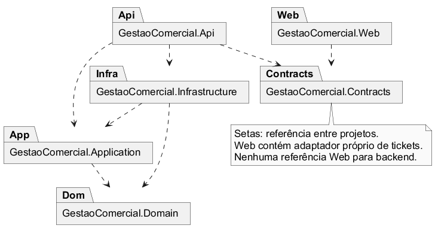
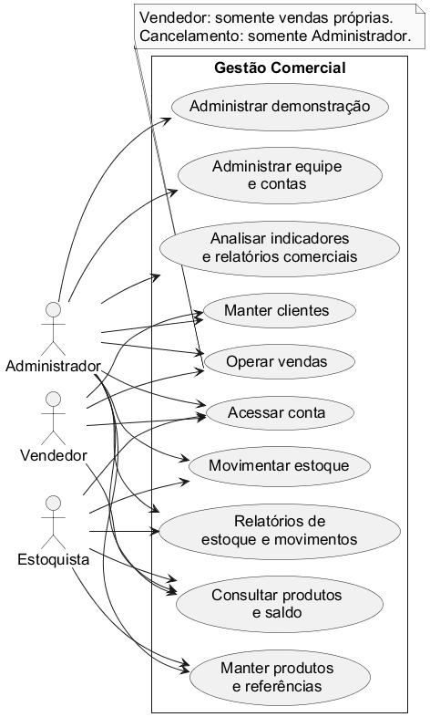
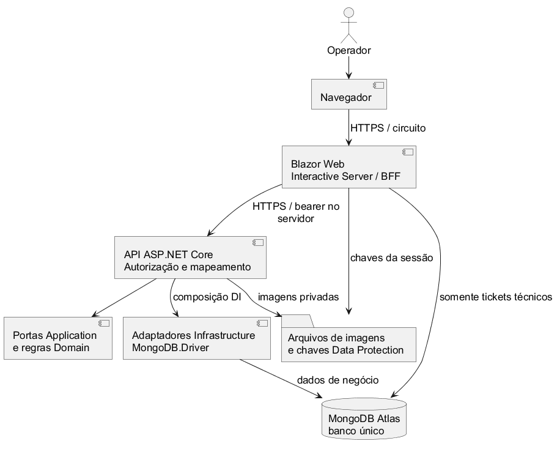
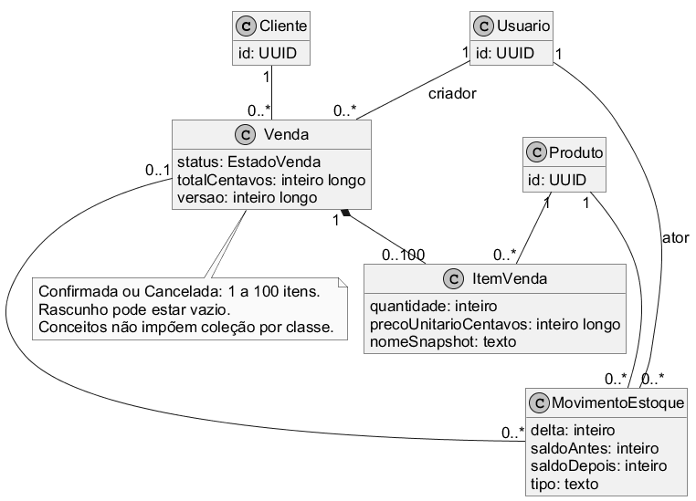
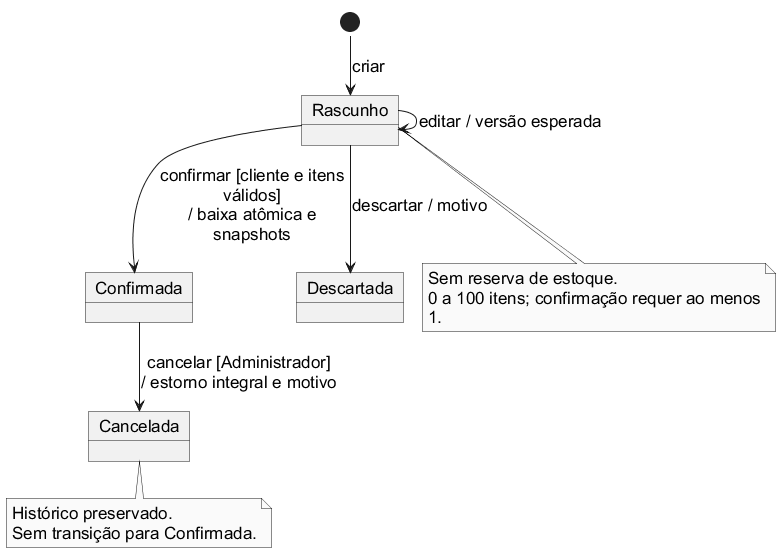
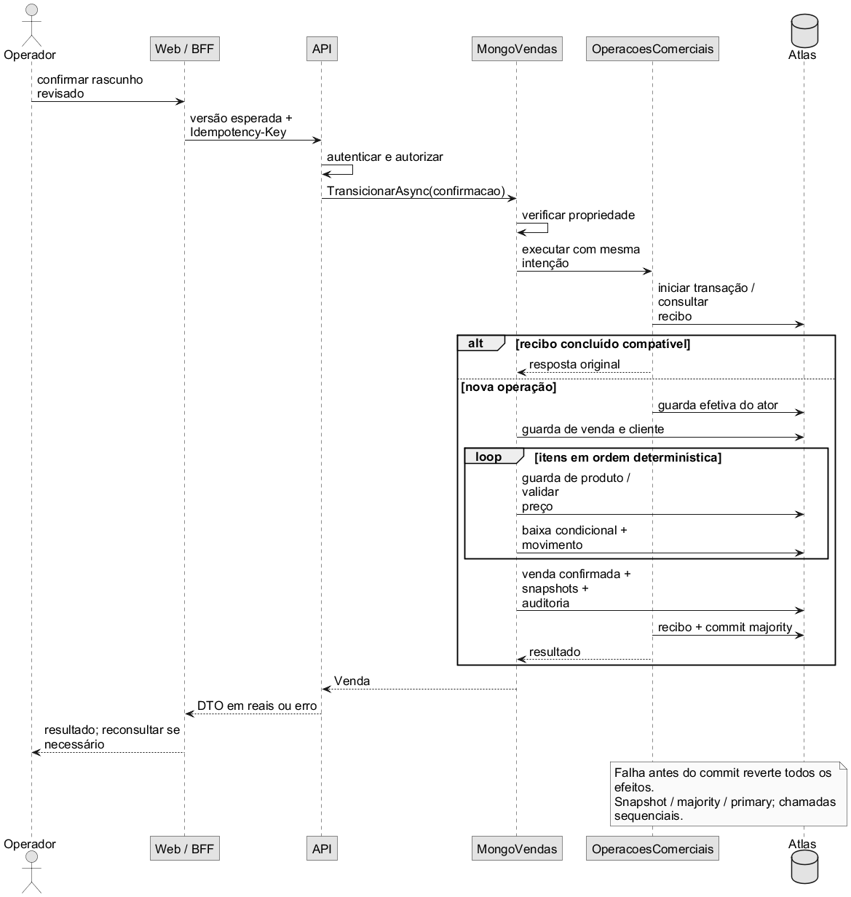

# Desenvolvimento de um sistema web de gestão comercial com ASP.NET Core Blazor e MongoDB

[INSTITUIÇÃO A PREENCHER]

[CURSO A PREENCHER]

[AUTOR A PREENCHER]

[CIDADE A PREENCHER]

[ANO ACADÊMICO A PREENCHER]

<!-- page -->

# Folha de rosto

[AUTOR A PREENCHER]

Desenvolvimento de um sistema web de gestão comercial com ASP.NET Core Blazor e MongoDB

Trabalho de Conclusão de Curso apresentado a [INSTITUIÇÃO A PREENCHER], no curso de [CURSO A PREENCHER], como requisito [NATUREZA E TITULAÇÃO A CONFIRMAR].

Orientador ou orientadora: [NOME E TITULAÇÃO A PREENCHER].

[CIDADE A PREENCHER]

[ANO ACADÊMICO A PREENCHER]

<!-- page -->

# Folha de aprovação

[AUTOR A PREENCHER]

Desenvolvimento de um sistema web de gestão comercial com ASP.NET Core Blazor e MongoDB

Trabalho apresentado a [INSTITUIÇÃO A PREENCHER], no curso de [CURSO A PREENCHER].

Data de aprovação: [PREENCHER APÓS A DEFESA].

Banca examinadora: [NOMES, TITULAÇÕES E INSTITUIÇÕES A PREENCHER].

Esta folha é um modelo pendente. Não registra aprovação acadêmica nem contém assinaturas.

<!-- page -->

# Resumo

Este trabalho apresenta o desenvolvimento de um protótipo web de gestão comercial voltado à integração entre cadastros, controle de estoque e registro de vendas. O problema técnico investigado é como manter coerência entre o estado de uma venda, as quantidades disponíveis e o histórico das operações, com permissões diferenciadas e preservação de valores financeiros. O sistema utiliza ASP.NET Core, Blazor Web App com interatividade no servidor e MongoDB, com separação física entre frontend e backend. A metodologia compreende análise dos artefatos do projeto, modelagem dos requisitos e fluxos, exame da implementação e organização das evidências históricas de avaliação técnica com dados fictícios. A solução emprega centavos inteiros, transações multidocumento, atualizações condicionais, controle de versão e recibos de idempotência. Os perfis Administrador, Vendedor e Estoquista recebem acessos delimitados, verificados na API. A documentação examinada registra testes de regras, integração e homologação; esses resultados são apresentados com sua data e abrangência, sem equivaler a nova execução da versão analisada. O resultado deste trabalho documental é uma descrição rastreável do protótipo, acompanhada de modelos UML, especificação técnica e manual de uso. A análise identifica mecanismos adequados às invariantes definidas, mas não demonstra ganhos em empresas, desempenho de produção ou validação por usuários finais. Conclui-se que o protótipo permite estudar de forma integrada consistência transacional, segurança e modelagem documental em um cenário acadêmico de gestão comercial.

Palavras-chave: gestão comercial; engenharia de software; MongoDB; Blazor; consistência transacional.

<!-- page -->

# Abstract

This work presents the development of a web-based commercial management prototype that integrates master data, inventory control, and sales recording. The technical problem is how to maintain consistency among sale status, available quantities, and operation history while enforcing role-based permissions and preserving financial values. The system uses ASP.NET Core, a Blazor Web App with server-side interactivity, and MongoDB, with physically separated frontend and backend projects. The method comprises analysis of project artifacts, requirements and workflow modeling, implementation inspection, and organization of historical technical evaluation records using fictitious data. The solution uses integer minor currency units, multi-document transactions, conditional updates, version control, and idempotency receipts. Administrator, Salesperson, and Stockkeeper roles receive restricted access enforced by the API. The reviewed documentation reports rule tests, integration tests, and acceptance activities; their dates and scope are preserved rather than presented as a new execution of the analyzed version. The documentary outcome is a traceable description of the prototype, supported by UML models, a technical specification, and a user manual. The analysis identifies mechanisms aligned with the defined invariants but does not establish business benefits, production performance, or end-user validation. The prototype provides an academic setting for studying transactional consistency, security, and document-oriented modeling in commercial management.

Keywords: commercial management; software engineering; MongoDB; Blazor; transactional consistency.

<!-- lists -->
<!-- toc -->

# 1 Introdução

## 1.1 Contextualização e problema

O registro de uma venda exige mais do que armazenar uma lista de produtos. A confirmação relaciona cliente, operador, preços, quantidades e disponibilidade; seu cancelamento deve recompor as quantidades sem apagar a operação original. Se essas alterações forem independentes, uma interrupção pode produzir venda confirmada sem baixa, baixa sem movimento ou estorno duplicado. Essa possibilidade define o problema técnico abordado pelo protótipo Gestão Comercial.

A investigação se restringe a uma empresa hipotética, um estoque por produto, quantidades inteiras e moeda BRL. Não se parte de entrevistas ou observações de uma organização real. A motivação é construir e explicar um artefato de software cujo comportamento possa ser confrontado com requisitos, código e testes. Assim, afirmações sobre redução de custos, satisfação ou produtividade não integram os resultados, pois exigiriam outra estratégia de pesquisa e evidências que não estão disponíveis.

A questão orientadora é: como organizar uma aplicação web de gestão comercial que preserve a coerência entre vendas e estoque, com autorização por perfil e histórico verificável, utilizando a plataforma .NET e persistência documental MongoDB? A resposta é desenvolvida por meio da análise da implementação e dos mecanismos escolhidos, não por comparação experimental entre tecnologias.

## 1.2 Objetivos

O objetivo geral é desenvolver e documentar um protótipo web de gestão comercial que integre cadastros, estoque e vendas, preservando as invariantes comerciais definidas para a demonstração acadêmica.

Os objetivos específicos são: especificar requisitos e permissões; representar os principais fluxos e estruturas; separar apresentação, contratos HTTP, regras e persistência; implementar cálculos monetários exatos; controlar confirmação e cancelamento com atomicidade e idempotência; disponibilizar consultas gerenciais e exportações; e relacionar os comportamentos às evidências de avaliação disponíveis.

## 1.3 Justificativa e delimitação

A contribuição acadêmica está na conexão entre modelagem e implementação. Uma regra como impedir estoque negativo aparece em diferentes níveis: validação de entrada, cálculo de saldo, filtro condicional, transação e teste de concorrência. A documentação permite examinar a função de cada proteção e reconhecer que mecanismos isolados não resolvem todos os modos de falha.

A solução é demonstrada localmente, com dois processos na máquina do apresentador e acesso ao Atlas existente pela internet. O escopo inclui autenticação, equipe e contas, clientes, produtos e referências, estoque, vendas, dashboard, cinco relatórios e administração de dados fictícios. Não inclui catálogo público, pedidos online, pagamentos, integração fiscal, múltiplos estoques ou operação pública em produção.

## 1.4 Organização do trabalho

O capítulo 2 apresenta os conceitos usados para interpretar a solução. O capítulo 3 descreve o procedimento documental e seus limites. O capítulo 4 relaciona os requisitos à estrutura e aos fluxos implementados. O capítulo 5 examina as evidências de avaliação, distinguindo resultados registrados de verificações desta documentação. O capítulo 6 sintetiza as contribuições e as limitações. A especificação técnica e o manual acompanham a monografia como documentos complementares produzidos para este trabalho.

# 2 Fundamentação teórica

## 2.1 Engenharia de software e rastreabilidade

O SWEBOK distingue requisitos de produto e restrições do projeto e caracteriza requisitos funcionais pelo comportamento observável. Também trata a rastreabilidade como relação entre requisitos e outros produtos de trabalho (Washizaki, 2026). Neste estudo, essa perspectiva orienta a conexão entre RF, RN, CA, casos de uso, componentes e testes. A matriz criada é uma interpretação dos artefatos existentes; não prova, por si, que cada teste passou.

O catálogo e o sumário da décima edição de Software Engineering situam requisitos, modelagem, arquitetura, implementação e testes entre os assuntos da disciplina (Sommerville, 2016). A obra é utilizada aqui para contextualização dessa abrangência, sem atribuir citações literais ou páginas não consultadas. A fundamentação dos mecanismos concretos utiliza também fontes primárias dos fornecedores e organismos responsáveis.

## 2.2 Modelagem com UML

A UML 2.5.1 é publicada pelo Object Management Group como linguagem de modelagem de sistemas (Object Management Group, 2017). Neste trabalho, casos de uso expressam objetivos dos atores; classes representam estruturas; sequências mostram colaboração ao longo do tempo; atividades descrevem decisões de fluxo; e estados delimitam as transições da venda.

O modelo conceitual não é apresentado como reprodução automática do código. Cliente, Produto e Venda são conceitos do negócio, enquanto parte das estruturas reais são records da Application e documentos BSON construídos na Infrastructure. Essa distinção impede que uma representação de análise seja confundida com um conjunto de entidades C# inexistentes no Domain. O modelo documental, por sua vez, utiliza convenções gráficas explicitadas e não reivindica ser um esquema relacional.

## 2.3 Separação de responsabilidades e aplicação web

A documentação de arquitetura da Microsoft descreve a separação lógica de responsabilidades e a organização de dependências por abstrações (Microsoft, s.d.a). A solução analisada aplica essa orientação com projetos Domain, Application, Infrastructure e Api, além do Web e dos contratos compartilhados. A direção das referências é verificável nos arquivos dos projetos.

Como decisão específica deste protótipo, a interface usa interatividade no servidor e clientes HTTP para a API. O navegador participa de um circuito Blazor; o processo Web atua como intermediário e mantém o token da API no servidor. A tecnologia reduz a necessidade de duplicar regras comerciais em JavaScript, mas estabelece dependência de conexão com o processo Web. Não foram produzidas medições que demonstrem vantagem de desempenho ou usabilidade frente a outras interfaces.

O frontend referencia somente os contratos compartilhados entre os projetos de produção. Seu adaptador MongoDB tem finalidade técnica de sessão e não concede acesso comercial pelo desenho da aplicação. A existência desse adaptador deve ser explicitada: afirmar que o Web não utiliza o driver seria incorreto. A restrição arquitetural é o acesso aos dados de negócio e a ausência de referências aos projetos do backend.

## 2.4 Persistência documental e transações

O manual MongoDB distingue a incorporação de dados relacionados e o armazenamento por referências; o tamanho e a forma de acesso ajudam a orientar essa escolha (MongoDB, s.d.c). Neste projeto, os itens de venda e seus snapshots são limitados e incorporados à venda. Os movimentos ficam separados porque constituem histórico crescente. Essa distribuição é uma decisão de modelagem do artefato, não uma regra universal para aplicações comerciais.

O MongoDB oferece atomicidade por documento e transações para operações que atravessam documentos; as garantias dependem da configuração de leitura e escrita (MongoDB, s.d.a). A confirmação altera venda, produtos, movimentos, auditoria e recibo, razão pela qual precisa de uma transação. A execução usa snapshot, majority e primary. O driver associa as operações a uma sessão e recomenda reutilizar o cliente; a sessão da transação é utilizada sequencialmente (MongoDB, s.d.b).

Validadores de esquema permitem restringir tipos e limites locais (MongoDB, s.d.d). No protótipo, esses validadores reforçam invariantes documentais, enquanto existência de referências, permissões e condições envolvendo coleções são verificadas no backend. O banco não é descrito como desprovido de esquema, nem seus identificadores são tratados como chaves estrangeiras mantidas automaticamente.

## 2.5 Segurança e autorização

A orientação OWASP inclui menor privilégio, negação por padrão e conferência de autorização em cada requisição (OWASP Foundation, s.d.a). O protótipo associa policies às rotas e revalida a sessão. A regra de propriedade também limita as vendas consultadas por Vendedor. Ocultar uma opção de menu contribui para a navegação, mas o efeito de segurança depende da recusa na API.

A documentação Blazor distingue verificações confiáveis no servidor daquelas executadas em cliente controlável pelo usuário (Microsoft, s.d.b). O projeto usa formulário HTTP protegido para login e logout, cookie de referência e armazenamento protegido do token no processo Web. Essa organização evita renderizar o bearer no HTML; não dispensa TLS, gestão de chaves e revisão operacional. Não se declara certificação ou ausência absoluta de vulnerabilidades.

## 2.6 Representação monetária e testes

O contexto checked de C# permite detectar overflow em operações inteiras (Microsoft, s.d.c). A decisão do projeto é representar dinheiro por centavos long, com limites comerciais adicionais. Quantidade inteira multiplicada por preço inteiro produz subtotal exato, sem arredondamento intermediário. A média de indicadores tem regra própria, aplicada apenas no resultado final.

Testes de regra isolam cálculos e transições, enquanto testes de integração verificam os efeitos no armazenamento real. O módulo MongoDB do Testcontainers documenta suporte a replica set (Testcontainers, s.d.). O projeto também admite Atlas com bancos descartáveis isolados por execução. Esse isolamento pertence às fixtures e não cria outro ambiente de apresentação. Não seria adequado substituir o mecanismo transacional por coleção em memória para comprovar rollback ou disputa por saldo.

# 3 Metodologia

## 3.1 Natureza do trabalho e unidade de análise

O trabalho é apresentado como desenvolvimento de protótipo acadêmico acompanhado de análise documental e técnica do artefato. Sua unidade de análise é o repositório Gestão Comercial, no commit 1940b83460ec93d8efa2011db9dc9177570b0586, consultado em 24 de novembro de 2026. A versão documental é posterior a esse commit e não altera o comportamento da aplicação.

Essa caracterização não pretende comprovar a execução histórica de um protocolo formal de pesquisa. O procedimento agora realizado consiste em inspecionar artefatos existentes e sistematizar uma descrição verificável. Não há amostra de empresas, questionário, entrevista, experimento com usuários ou autorização ética de pesquisa a declarar. O contexto e os dados são fictícios.

## 3.2 Materiais e procedimento

Foram considerados o índice e o estado do projeto, requisitos, regras, critérios de aceite, decisões técnicas, documentação de arquitetura, código dos seis projetos de produção, testes e configuração pública de compilação. Segredos, arquivos de acesso e conteúdo do banco de apresentação não são fontes deste estudo documental.

A análise começa pela identificação do escopo vigente e pela precedência das decisões recentes. Em seguida, os requisitos são confrontados com contratos, rotas, policies, implementações de persistência e nomes de testes. Os diagramas são elaborados com recortes explícitos para manter legibilidade. As fontes bibliográficas são consultadas em páginas oficiais, registrando o que efetivamente sustenta cada citação. Por último, os textos são montados em documentos editáveis e revisados após renderização.

## 3.3 Critério de evidência

As afirmações são classificadas em três níveis. Inspeção atual corresponde a fatos observados em arquivos da versão analisada. Evidência histórica corresponde a resultados registrados em documentos anteriores, associados a data, commit ou execução. Pendente corresponde a item cuja comprovação não foi localizada ou cuja medição não foi realizada. Essa classificação evita transformar a presença de código de teste em resultado de execução.

Contagens de testes de execuções distintas não são somadas como se compusessem uma suíte única. Resultados CI do início de novembro não demonstram automaticamente os ajustes posteriores de interface. Da mesma forma, capturas estáticas são úteis para discutir layout, mas não demonstram autenticação, integridade de estoque ou conclusão de uma venda.

## 3.4 Limitações metodológicas

A documentação histórica inclui etapas superadas e metas originalmente operacionais que deixaram de integrar o escopo acadêmico. As seções de catálogo e pedidos e as metas de carga massiva, disponibilidade e recuperação não são tomadas como funcionalidades ou resultados do MVP. As divergências permanecem registradas na especificação complementar.

A análise estática confirma a existência de mecanismos e testes, mas não substitui sua execução. Nesta produção documental não se acessa o Atlas, não se inicia uma jornada comercial e não se altera o banco de demonstração. Consequentemente, os resultados empíricos discutidos são aqueles registrados nas fontes históricas identificadas, com o alcance e a incerteza correspondentes.

# 4 Desenvolvimento do sistema

## 4.1 Atores e requisitos

Administrador mantém equipe e contas, atua sobre os módulos comerciais e acessa indicadores e demonstração. Vendedor mantém clientes e opera apenas suas vendas, sem cancelamento. Estoquista mantém produtos e referências, registra entradas e saídas manuais e consulta relatórios de estoque e movimentos; o ajuste de saldo é reservado ao Administrador. As permissões são fixas, sem editor arbitrário ou múltiplos perfis por conta.

Os vinte requisitos funcionais RF-01 a RF-20 abrangem autenticação e saída, contas, funcionários, clientes e histórico, referências, produtos, estoque, vendas, dashboard e relatórios. A limpeza da demonstração é uma exceção documentada pela ADR-39 e tem identificação própria, sem renumerar requisitos anteriores. A matriz completa e os casos de uso estão na Documentação técnica.

O ator Cliente não participa diretamente da aplicação: é um cadastro utilizado nas vendas. Não existe autoatendimento público. Funcionário também não equivale automaticamente a usuário; uma conta humana requer vínculo com funcionário, e o administrador inicial é a exceção prevista para provisionar a instalação.

## 4.2 Arquitetura implementada

Domain concentra funções de validação e invariantes, como DadosProduto, DocumentoCliente, Movimentacao e RegrasVenda. Application define portas específicas e records de entrada e resultado, como IVendas, IEstoque, Venda e ItemVenda. Infrastructure implementa essas portas com o driver oficial, mapeamento BSON e coordenação das transações. Api é a composição e a borda HTTP.

O desenho não deve ser descrito como um domínio inteiramente composto de agregados ricos: existem regras em classes estáticas e estruturas de resultado na Application, e a coordenação concreta está nos adaptadores MongoDB. Esse fato é relevante para avaliar o acoplamento real. O projeto evita repositório genérico, barramento de mensagens e abstração artificial de unidade de trabalho.

O Web contém componentes Razor, clientes HTTP, gerenciamento da sessão e armazenamento técnico de tickets. Contracts contém requests e responses. A API converte decimal em reais para centavos e converte os resultados de volta para a borda. Os contratos não transportam documentos BSON nem são usados como entidades de persistência.

## 4.3 Modelagem comercial e documental

Produto pertence a uma categoria e pode ter marca. Seu documento incorpora quantidade e versão do saldo, além de metadados opcionais da imagem. O arquivo da imagem fica em diretório privado; não se incorpora binário ao documento. Categoria e marca permanecem coleções próprias por possuírem manutenção e unicidade independentes.

Venda incorpora até cem itens. Cada item mantém UUID próprio, produtoId, quantidade, SKU e nome copiados, preço unitário e total em centavos. A confirmação também congela dados do cliente e o evento do operador. A consulta histórica não reconstrói o preço ou o nome antigo a partir do cadastro atual. Isso permite inativar ou renomear cadastros sem apagar o significado comercial da operação.

Os movimentos são documentos separados. Guardam produto, delta, saldos anterior e posterior, tipo, motivo, ator e instante; os comerciais referenciam venda e item. O saldo é materializado para operação, e a soma dos deltas permite conciliá-lo. Essa existência de histórico não caracteriza Event Sourcing, pois o estado atual não é reconstruído obrigatoriamente a partir de eventos para atender cada operação.

## 4.4 Estados, cálculos e confirmação

Uma venda nasce como Rascunho, podendo ser editada ou descartada. Confirmar exige cliente ativo, ao menos um item, produtos ativos e preço ainda compatível com o rascunho revisado. Confirmada pode ser cancelada integralmente por Administrador, com motivo. Não há transição de Cancelada para Confirmada, edição de itens confirmados ou devolução parcial.

Por exemplo, duas unidades a R$ 12,50 são representadas por 2 × 1.250 = 2.500 centavos. A borda mostra R$ 25,00. A entrada de uma terceira casa decimal é rejeitada, em vez de ser arredondada silenciosamente. O limite de preço é 999.999.999 centavos, o total por venda é limitado e as operações usam checked. Esses limites pertencem à especificação comercial da aplicação.

Na confirmação, uma transação coordena guardas efetivas de ator, venda, cliente e produtos; baixa condicional de cada saldo; movimentos; estado; snapshots; auditoria; e recibo. As operações são sequenciais. Havendo insuficiência no segundo produto, o primeiro decremento também é revertido. A consulta por snapshot não é tratada como garantia de serialização: alterações efetivas de guardVersion coordenam condições que poderiam sofrer leitura obsoleta.

## 4.5 Concorrência, cancelamento e idempotência

Uma versão esperada identifica a revisão do documento que o usuário pretende alterar. Versão antiga provoca conflito e exige releitura. Essa proteção atende edição concorrente; não responde sozinha ao caso de perda da resposta depois do commit. Para esse segundo problema, comandos comerciais usam chave UUID e recibo por ator, escopo e chave, associados a um hash da intenção normalizada.

Repetir a mesma intenção concluída devolve seu recibo sem repetir efeitos. Reutilizar chave com outro corpo provoca conflito. A chave é preservada quando o resultado é incerto. O código diferencia falha transitória da transação e incerteza no commit, evitando iniciar novo corpo quando apenas o resultado do commit é desconhecido. A chave não substitui autenticação nem permite ignorar a propriedade da venda.

O cancelamento estorna a quantidade original de cada item e mantém baixa, snapshots e confirmação. Produto inativo ainda pode receber o estorno. A capacidade máxima do saldo é verificada; ultrapassá-la impede toda a operação. Mesma chave retorna recibo; uma nova intenção sobre venda já cancelada encontra estado inválido. Assim, estado, transação, recibo e unicidade de movimento protegem aspectos complementares.

## 4.6 Segurança, consulta e demonstração

As contas usam hash de senha Identity e securityStamp. Sessões API persistem hash do token, instantes de uso e revogação; tickets Web armazenam conteúdo protegido por Data Protection. A alteração de perfil ou senha e a inativação revogam o acesso conforme os fluxos definidos. O último administrador recebe proteção transacional para que alterações concorrentes não deixem a instalação sem administração.

O dashboard usa período civil convertido no fuso configurado. Receita líquida soma apenas vendas atualmente Confirmadas do conjunto selecionado por confirmadoEm; canceladas continuam aparecendo no histórico e contribuem com zero. Se uma venda de R$ 15,00 for cancelada depois de outra de R$ 25,00, a visão atual desse conjunto indica R$ 25,00. Isso não é fechamento contábil histórico nem fluxo de caixa.

Os relatórios disponíveis são vendas, operadores, produtos, estoque e movimentos, com paginação e CSV. O estoque é atual, sem consulta retroativa de saldo. A exportação possui limite de dez mil linhas e não trunca silenciosamente. O risco de fórmulas interpretadas por planilhas é descrito pela OWASP (OWASP Foundation, s.d.b); o código CsvSeguro e seus testes tratam a neutralização, sem afirmar que toda combinação de planilha e configuração tenha sido certificada.

O gerador da demonstração cria ou retoma dados fictícios e registra proveniência. Restaurar verifica alterações e dependências manuais antes de remover somente dados demonstrativos comprovados. Limpar é uma ação diferente: a ADR-39 autoriza excluir também histórico e dados manuais mediante confirmação explícita, preservando administrador executor, vínculo, sessão e estrutura técnica. A preservação do histórico é a regra comercial normal, com essa exceção acadêmica delimitada.

# 5 Avaliação e resultados

## 5.1 Verificações desta documentação

A inspeção atual identifica SDK fixado em 10.0.401, MongoDB.Driver 3.11.2, xUnit 2.9.3 e Testcontainers.MongoDb 4.14.0. Esses números são configurações dos arquivos públicos, não versões aferidas de um servidor Atlas em execução. Também são inspecionados contratos, schemas, policies, rotas e métodos de teste. A entrega documental preserva inventário e hashes para permitir comparação posterior.

Não foram executados testes da aplicação nem acessos ao banco durante esta tarefa. As verificações novas se referem à consistência documental, fontes e renderização dos arquivos. A existência de um teste nomeado na matriz indica localização de uma especificação executável, sem substituir evidência de execução.

## 5.2 Resultados históricos identificados

| Registro | Resultado registrado | Limite da inferência |
| --- | --- | --- |
| Homologação de 07/11/2026, código 0d49db9 | CI de 242 testes, build aprovado e jornadas funcionais registradas | Evidência histórica daquele código, sem reexecução nesta documentação |
| Limpeza explícita de 09/11/2026 | 128 testes unitários e 30 integrações direcionadas registrados | Soma da validação local descrita, não suíte integral atual |
| Identidade visual de 23/11/2026 | Build Web e montagem estática em quatro larguras registrados | Não comprova jornada autenticada nem validação por usuários |

Fonte: registros do estado do projeto e relatório de homologação, preservados no repositório. A tabela reproduz resultados declarados nessas fontes; os logs originais não estão todos disponíveis neste checkout.

O roteiro histórico registra uma entrada de vinte unidades, venda de três, saldo de dezessete e retorno a vinte após cancelamento, preservando movimentos. Também descreve verificação por perfil e exportações CSV. Esse cenário é pertinente porque reúne cálculos, transação e estorno; entretanto, não autoriza declarar que uma execução equivalente foi repetida agora.

## 5.3 Cobertura técnica e critérios de avaliação

No código, SalesTests contém cenários de ciclo completo, insuficiência de múltiplos itens, rollback por falha de auditoria, concorrência pela última unidade, idempotência, propriedade e alterações de referência. StockTests aborda conciliação, imutabilidade, insuficiência, overflow e autorização. ReportsTests trata os cinco relatórios e seus filtros e totais. DemonstrationCleanupTests cobre preservação do executor, rollback, revogação e recarga posterior.

A relação com os objetivos é observável: os cadastros integram os fluxos; confirmação e cancelamento possuem protocolos coordenados; permissões são expressas em policies; e indicadores reutilizam dados transacionais. Contudo, inspeção e resultados históricos devem permanecer separados. Não se quantifica cobertura percentual de código sem relatório correspondente, nem se usa a contagem de métodos para inferir quantidade de casos executados por theories parametrizadas.

## 5.4 Discussão e ameaças à validade

A validade interna depende da fidelidade entre documentação e versão do código. O registro de commit, inventário e referências a métodos reduz ambiguidades, mas não recupera logs ausentes. Há também risco de textos históricos contraditórios; por isso, decisões vigentes são explicitadas e trechos superados não aparecem como escopo atual.

A validade externa é limitada: uma única aplicação, cenário fictício, infraestrutura Atlas específica e ausência de usuários reais impedem generalizar produtividade, aceitação ou capacidade operacional. As metas antigas de latência com vinte usuários e de recuperação não foram comprovadas nesta análise e não são apresentadas como resultado. Não há evidência de certificação de acessibilidade, teste de penetração completo ou operação contínua.

O principal compromisso da solução documental é tornar verificável o que foi implementado e o que ainda exige demonstração. O uso de MongoDB não elimina a necessidade de transações; o uso de camadas não garante automaticamente bom domínio; e recibos não eliminam a necessidade de reconsulta após resposta perdida. A contribuição está em explicitar essas relações e seus limites no artefato estudado.

# 6 Considerações finais

O protótipo organiza cadastros, estoque, vendas e consultas gerenciais em uma aplicação web com responsabilidades separadas. A análise mostra como centavos inteiros, transações, filtros condicionais, versões, guardas e recibos se combinam para atender regras comerciais. Os modelos e a matriz de rastreabilidade permitem relacionar esses mecanismos aos objetivos e às especificações executáveis existentes.

O objetivo documental é atendido pela monografia, pela especificação técnica e pelo manual, com fontes editáveis dos diagramas. A conclusão técnica permanece delimitada: o código possui mecanismos alinhados às invariantes e o histórico registra validações, mas esta tarefa não reexecuta a aplicação nem demonstra resultados organizacionais. A versão acadêmica exige completar identificação, revisar o texto com o orientador e adequar a apresentação às regras da instituição.

Como trabalhos futuros, propõem-se avaliação de usabilidade com protocolo próprio, ensaios de desempenho representativos, verificação de recuperação e revisão de segurança operacional. Eventuais expansões comerciais exigiriam levantamento e novas decisões. Essas possibilidades não são funcionalidades entregues nem etapas automaticamente autorizadas pelo presente estudo.

# Referências

<!-- references -->

# Apêndice A Artefatos produzidos

A Documentação técnica reúne requisitos, casos de uso UC01 a UC29, matriz de rastreabilidade, inventário de contratos e dicionário de dados. O Manual do usuário apresenta procedimentos por perfil, execução e tratamento de mensagens. A pasta diagramas contém 22 modelos, cada um com fonte PlantUML e exportações SVG e PNG. São apêndices autorais desta entrega; referências externas consultadas não foram reproduzidas integralmente como anexos.

# Apêndice B Pendências para submissão

Completar autor, instituição, curso, natureza do trabalho, orientador, cidade e ano acadêmico. Conferir necessidade de ficha catalográfica, folha de aprovação institucional, assinaturas e declarações. Revisar o resumo e o abstract após orientação. Conferir se a instituição aceita a estrutura de monografia e as convenções adotadas. As edições pertinentes das normas foram identificadas por orientação pública de biblioteca universitária (Universidade Federal do Espírito Santo, s.d.). Esta versão utiliza apresentação ABNT provisória, sem presumir acesso à íntegra licenciada de todas as normas.
