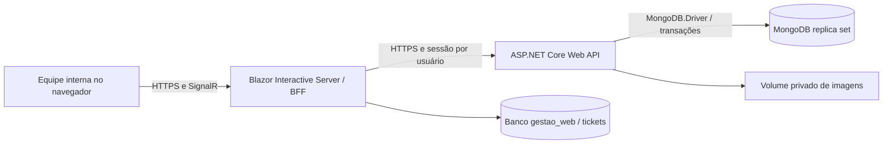

# 01 — Visão geral

## Objetivo e limites

Construir o GestaoComercial, sistema web para gestão interna de uma empresa, usado como TCC de Engenharia de Software. A implementação atual cobre00–06; gates e validações correntes no estado03.00–06 aprovados com199 testes no CI final, conforme estado03. A modelagem parte das regras presentes e não utiliza diagrama ou banco do TCC antigo.

O MVP cobre acesso, funcionários, clientes, produtos, estoque, vendas, dashboard e relatórios. Não cobre emissão fiscal, contas a pagar/receber, processamento de pagamento, multiempresa, múltiplos depósitos nem comércio eletrônico. [Escopo e hipóteses](../requirements/01-ESCOPO.md).

## Atores e responsabilidades

| Ator | Responsabilidade |
| --- | --- |
| Administrador | Contas, perfis e configuração operacional; acesso completo |
| Vendedor | Clientes e ciclo de vendas, sem cancelamento confirmado |
| Estoquista | Produtos, entradas e saídas manuais |

A [matriz](../requirements/05-MATRIZ-PERMISSOES.md) é normativa para os limites de cada perfil.

## Contexto

BFF significa o servidor web que intermedeia chamadas da interface à API. Navegador não recebe o token da API. O frontend acessa apenas seu armazenamento técnico de sessões, nunca coleções de negócio.

## Fluxo comercial de referência

1. Administrador cadastra funcionário e, opcionalmente, uma conta.
2. Estoquista cadastra produto e registra entrada de 10 unidades.
3. Vendedor registra cliente e rascunho com 2 unidades a R$ 12,50 cada.
4. Confirmação valida preço e status, totaliza R$ 25,00 e baixa saldo para 8 em uma transação.
5. Administrador cancela com motivo; transação devolve 2 unidades, preservando venda e baixa originais.
6. Dashboard e relatórios mostram receita líquida zero, uma venda cancelada e histórico de ambos os movimentos.

## Estratégia e critérios de sucesso

- Monólito modular na API, camadas Clean Architecture e frontend independente por HTTP.
- Cada bloco tem uma demonstração utilizável e testes; módulos seguintes não são pré-requisitos ocultos.
- Sucesso: cenários CA-01 a CA-18 demonstrados em homologação e restauração de backup demonstrada antes de publicar.
- Prioridade P0: integridade, autenticação e autorização. P1: recursos administrativos e consulta. P2: fase posterior.

## Decisões e fontes

.NET 10 LTS é obrigatório e confirmado pela [política oficial de suporte](https://dotnet.microsoft.com/en-us/platform/support/policy/dotnet-core). Fixar a versão de correção disponível ao implementar; esta documentação não determina um patch futuro. As escolhas próprias do projeto estão no [registro ADR](../execution/04-DECISOES-TECNICAS.md).

Arquitetura vigente: ADR-20–30, MongoDB.Driver oficial e integração MongoDB real isolada, Atlas ou perfil Testcontainers.00–06 implementados; estado03 contém os gates e evidências. Perfis solicitados atualizados na ADR-30; sequência preservada.
