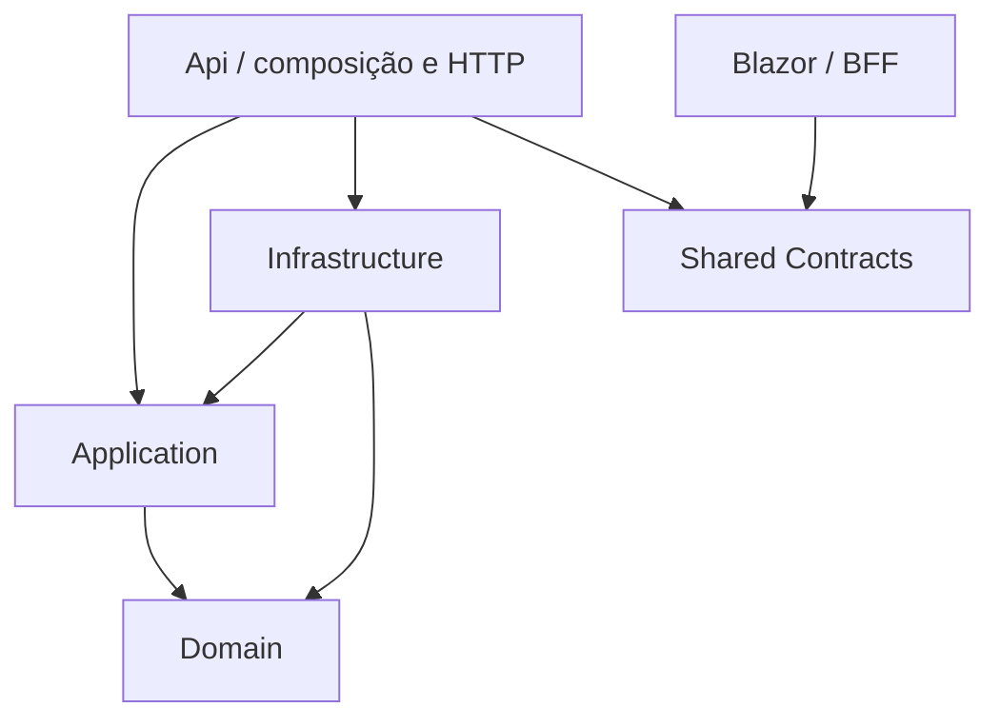

# 02 — Arquitetura

## Camadas e referências permitidas

Application não depende de DTOs HTTP: a API mapeia contratos para entradas/saídas de casos de uso. Referências transitivas não autorizam bypass de responsabilidades.

| Projeto | Responsabilidades | Proibições |
| --- | --- | --- |
| Domain | Entidades, invariantes, valores e transições | EF, HTTP, Identity, relógio global, arquivos |
| Application | Serviços de caso de uso, políticas de negócio, interfaces específicas de persistência/relógio/ator | DbContext, controllers, componentes Blazor |
| Infrastructure | EF, Npgsql, Identity, sessões, arquivos, implementação de transações | Decidir permissão por UI |
| Api | Autenticar, autorizar, validar transporte, mapear, ProblemDetails, DI | Consultar EF diretamente em endpoints de negócio |
| Frontend | Componentes pt-BR, formulário SSR de login, BFF, clientes HTTP tipados e sessão técnica | Referência ao backend ou acesso ao banco comercial |
| Shared Contracts | Requests, responses, paginação e códigos de erro HTTP | Entidades, lógica, serviços, tokens expostos ao cliente |

## Fluxo de escrita

## Persistência sem abstrações excessivas

Application define portas orientadas a casos concretos: consulta/gravação de clientes, produtos, estoque e vendas; transação comercial com operações explícitas de bloqueio. Infrastructure coordena um DbContext scoped e uma transação por comando. Não criar `IRepository<T>`, barramento ou uma camada de serviço para cada entidade sem comportamento.

O serviço de venda coordena várias entidades dentro da mesma unidade transacional. As portas precisam compartilhar a conexão/transação; implementações que abrem DbContexts independentes durante a confirmação são proibidas. Consultas projetam somente campos necessários e não carregam grafos inteiros.

## Tempo, erros e segurança

- `TimeProvider` ou porta de relógio permite testes de expiração e intervalos.
- Ator autenticado é construído no servidor a partir da sessão, nunca do corpo HTTP.
- Falha de negócio resulta em código estável e mensagem pt-BR; stack trace não sai do servidor.
- `CancellationToken` atravessa HTTP, caso de uso e EF. Cancelamento após commit não desfaz uma venda; reconsulta/repetição idempotente resolve resposta perdida.
- Dependências scoped não são guardadas em singleton. Circuito Blazor não mantém DbContext nem tokens em propriedades renderizadas.

## Justificativa

A separação permite testar invariantes sem infraestrutura e integridade no PostgreSQL real. Um único banco e uma API reduzem custo operacional e permitem atomicidade local. Não há justificativa atual para serviços distribuídos. Veja [ADR-01 a ADR-05](../execution/04-DECISOES-TECNICAS.md).

