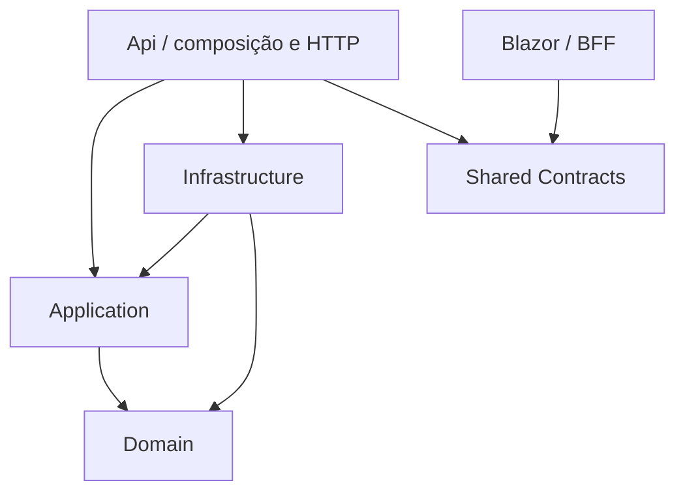
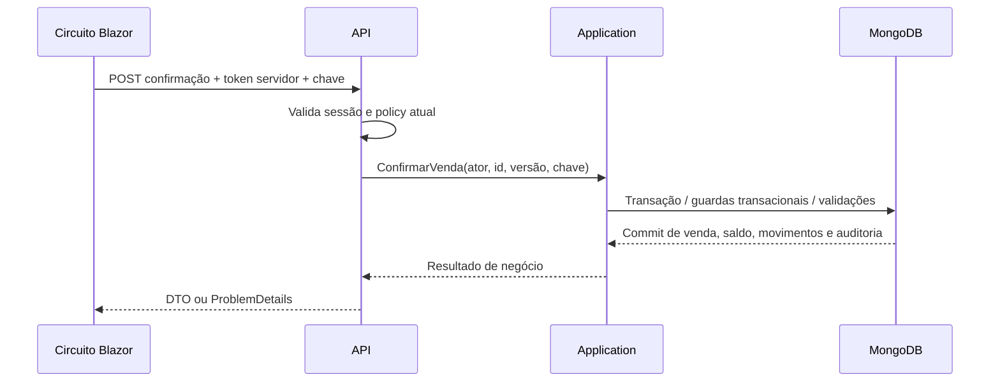

# 02 — Arquitetura

## Camadas e referências permitidas

Application não depende de DTOs HTTP: a API mapeia contratos para entradas/saídas de casos de uso. Referências transitivas não autorizam bypass de responsabilidades.

| Projeto | Responsabilidades | Proibições |
| --- | --- | --- |
| Domain | Entidades, invariantes, valores e transições | BSON, MongoDB.Driver, ASP.NET Core, Blazor, HTTP, Identity, relógio global, arquivos |
| Application | Serviços de caso de uso, políticas de negócio, interfaces específicas de persistência/relógio/ator | BSON, filtros/driver, implementação concreta de persistência, controllers, componentes Blazor |
| Infrastructure | MongoDB.Driver/BSON, stores Identity, sessões, arquivos, implementação de transações | Decidir permissão por UI |
| Api | Autenticar, autorizar, validar transporte, mapear, ProblemDetails, DI | Consultar MongoDB diretamente em endpoints de negócio |
| Frontend | Componentes pt-BR, formulário SSR de login, BFF, clientes HTTP tipados e sessão técnica | Referência ao backend ou acesso ao banco comercial |
| Shared Contracts | Requests, responses, paginação e códigos de erro HTTP | Entidades, lógica, serviços, tokens expostos ao cliente |

## Fluxo de escrita

## Persistência sem abstrações excessivas

Application define portas de persistência específicas aos casos reais e entradas/saídas sem BSON. Infrastructure implementa MongoDB.Driver oficial e coordena a sessão transacional por comando, com operações sequenciais e CancellationToken. Não criar IRepository<T>, Unit of Work artificial, barramento nem interface por entidade vazia. Um serviço comercial pode coordenar várias coleções na mesma sessão para preservar atomicidade.

IMongoClient é singleton por credencial/configuração, thread-safe e reutiliza conexões; sessão nunca é singleton nem compartilhada por requisições. API e Web usam o único banco gestao_comercial_dev; Web acessa somente tickets via adaptador técnico próprio (ADR-37). Frontend referencia apenas Contracts, sem backend. Stores de Identity são infraestrutura, não domínio. Filtros condicionais, validadores e versões pertencem ao adaptador; regras funcionais permanecem em Domain/Application. Confirmação/cancelamento e comandos administrativos seguem arquitetura 05, sem operações paralelas na transação.

products incorpora saldo/imagem e sales incorpora itens/snapshots limitados; movimentos, auditoria e sessões não crescem dentro dos agregados. Consultas projetam campos necessários e paginam no servidor. Detalhes de filtro/índice não trafegam no contrato HTTP.

## Tempo, erros e segurança

- `TimeProvider` ou porta de relógio permite testes de expiração e intervalos.
- Ator autenticado é construído no servidor a partir da sessão, nunca do corpo HTTP.
- Falha de negócio resulta em código estável e mensagem pt-BR; stack trace não sai do servidor.
- `CancellationToken` atravessa HTTP, caso de uso e adaptador MongoDB. Cancelamento após commit não desfaz uma venda; reconsulta/repetição idempotente resolve resposta perdida.
- Dependências scoped não são guardadas em singleton. Circuito Blazor não mantém adaptador de persistência nem tokens em propriedades renderizadas.

## Justificativa

A separação permite testar invariantes sem infraestrutura e integridade no MongoDB real. Um único banco no cluster Atlas existente e uma API reduzem custo operacional e permitem atomicidade local. Não há justificativa atual para serviços distribuídos. Veja [ADR-01/02/20–25](../execution/04-DECISOES-TECNICAS.md).
