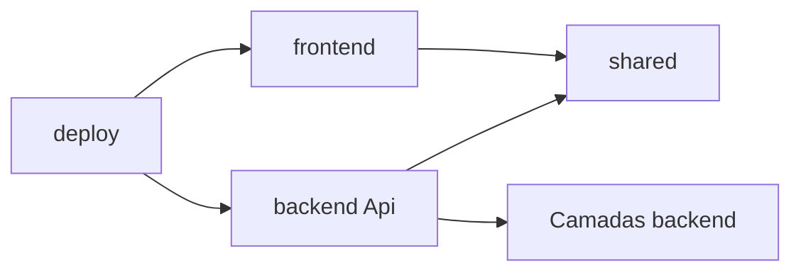

# 03 — Estrutura monorepo

## Estrutura planejada

Esta árvore é uma orientação para implementação futura; somente arquivos Markdown existem nesta entrega.

```text
GestaoComercial/
  AGENTS.md
  GestaoComercial.slnx
  global.json
  Directory.Build.props
  Directory.Packages.props
  .editorconfig
  .gitignore
  backend/
    src/
      GestaoComercial.Domain/
      GestaoComercial.Application/
      GestaoComercial.Infrastructure/
      GestaoComercial.Api/
    tests/
      GestaoComercial.Domain.Tests/
      GestaoComercial.Application.Tests/
      GestaoComercial.Api.IntegrationTests/
  frontend/
    src/GestaoComercial.Web/
    tests/GestaoComercial.Web.Tests/
  shared/
    GestaoComercial.Contracts/
  deploy/
    compose.yaml
    compose.production.yaml
    .env.example
  docs/
    README.md
    architecture/
    requirements/
    modules/
    execution/
```

## Organização interna

- Domain: pastas por conceito (`Vendas`, `Estoque`, `Cadastros`), sem dependência de framework web.
- Application: pastas por funcionalidade e serviço de caso de uso; validações de negócio próximas ao fluxo.
- Infrastructure: `Persistence`, `Identity`, `Sessions`, `Files`; migrations comerciais/Identity no contexto backend.
- Api: endpoints/controllers por recurso, políticas, mapeamento de erros e composição.
- Web: `Components/Pages`, formulários SSR de acesso, `ApiClients`, `Security`, contexto técnico próprio de sessões.
- Contracts: pastas de recursos com DTOs nomeados por operação; endpoints internos de autenticação nunca renderizam seus DTOs com tokens.

## Fluxo de dependências



## Convenções de repositório

Inicializar Git no bloco 00. Commits pequenos por bloco e propósito, incluindo documentação e testes. Versionar manifests, migrations e exemplos sem valores reais. Ignorar `.env`, segredos, chaves Data Protection, imagens de usuários, dumps, `bin`, `obj` e resultados locais.

Fixar SDK 10.0 e versões compatíveis de ASP.NET/EF/Npgsql após verificar o restore. Não usar versões flutuantes em CI ou imagens `latest`. O contexto técnico do frontend tem migrations próprias, sem referências a Infrastructure do backend; usuários PostgreSQL distintos limitam os schemas.

## Critério verificável

Na fundação, inspecionar referências de projetos e executar build da solução. Não pode existir caminho frontend → backend, Domain → EF/HTTP ou Application → Infrastructure. Cada diretório de teste corresponde ao que verifica; testes de API não substituem testes do BFF.

