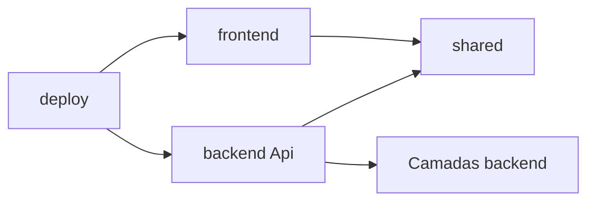

# 03 — Estrutura monorepo

## Estrutura planejada

Árvore da implementação00 autorizada, atualizada pela ADR-29; a configuração local .env permanece fora do Git.

```text
GestaoComercial/
  AGENTS.md
  GestaoComercial.slnx
  global.json
  Directory.Build.props
  Directory.Packages.props
  backend/
    GestaoComercial.Domain/
    GestaoComercial.Application/
    GestaoComercial.Infrastructure/
    GestaoComercial.Api/
  frontend/
    GestaoComercial.Web/
  shared/GestaoComercial.Contracts/
  tests/
    GestaoComercial.UnitTests/
    GestaoComercial.IntegrationTests/
  build/
  scripts/
  deploy/
  docs/
```

## Organização interna

- Domain: pastas por conceito (`Vendas`, `Estoque`, `Cadastros`), sem dependência de framework web.
- Application: pastas por funcionalidade e serviço de caso de uso; validações de negócio próximas ao fluxo.
- Infrastructure: `Persistence`, `Identity`, `Sessions`, `Files`; evoluções de persistência comerciais/Identity no contexto backend.
- Api: endpoints/controllers por recurso, políticas, mapeamento de erros e composição.
- Web: `Components/Pages`, formulários SSR de acesso, `ApiClients`, `Security`, adaptador próprio de armazenamento técnico de sessões.
- Contracts: pastas de recursos com DTOs nomeados por operação; endpoints internos de autenticação nunca renderizam seus DTOs com tokens.

## Fluxo de dependências



## Convenções de repositório

Inicializar Git no bloco 00. Commits pequenos por bloco e propósito, incluindo documentação e testes. Versionar manifests, evoluções de persistência e exemplos sem valores reais. Ignorar `.env`, segredos, chaves Data Protection, imagens de usuários, dumps, `bin`, `obj` e resultados locais.

Fixar SDK 10.0 e versões compatíveis de ASP.NET/MongoDB.Driver após verificar o restore. Não usar versões flutuantes em CI ou imagens `latest`. O armazenamento técnico do frontend tem evoluções de persistência próprias, sem referências a Infrastructure do backend; o banco único gestao_comercial_dev é compartilhado apenas no armazenamento; o frontend não consulta coleções comerciais (ADR-37).

## Critério verificável

Na fundação, inspecionar referências de projetos e executar build da solução. Não pode existir caminho frontend → backend, Domain → BSON/driver/HTTP ou Application → Infrastructure. Cada diretório de teste corresponde ao que verifica; testes de API não substituem testes do BFF.

## Revisão documental MongoDB

A árvore e nomes de projetos são preservados. Infrastructure/Persistence e Identity contêm documentos de persistência, serializers, índices/validadores, stores e coordenação transacional MongoDB.Driver; Web possui seu próprio adaptador técnico para tickets. Evoluções de persistência explícitas permanecem junto ao adaptador responsável, sem projeto genérico de migrador. A fundação00, autenticação01 e cadastros02–04 estão implementados e validados em Atlas, conforme estado03; Compose/CI permanecem preparados, sem execução local por ausência de Docker.
