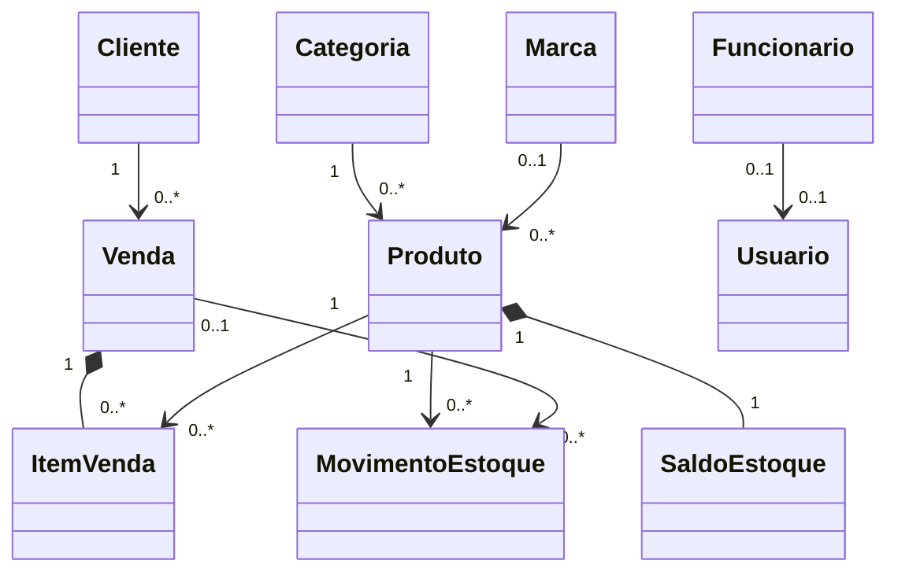
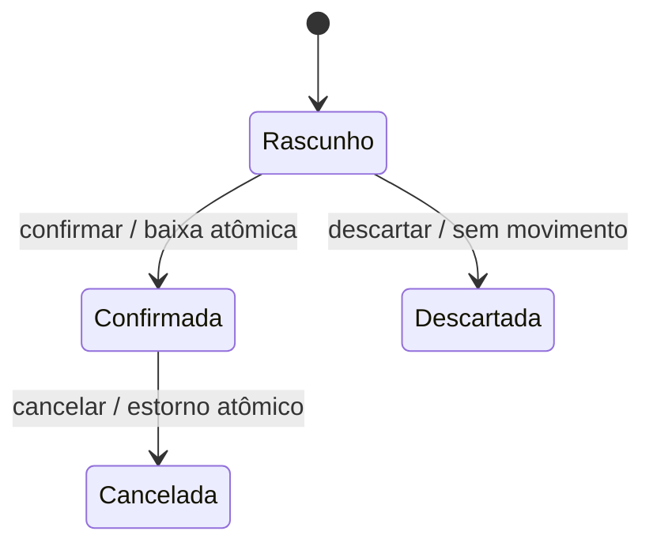

# 04 — Modelo de domínio

## Conceitos e atributos

| Conceito | Atributos e comportamento |
| --- | --- |
| Funcionário | Id, nome, email de contato opcional, telefone opcional, ativo, versão; desativar não apaga autoria |
| Usuário | Identity em Infrastructure, funcionário opcional, perfil único, ativo, versão de segurança; não é entidade de senha no Domain |
| Cliente | Id, nome, tipo PF/PJ, documento opcional, email/telefone opcionais, ativo, versão |
| Categoria / Marca | Id, nome, nome normalizado, ativo, versão |
| Produto | Id, SKU, nome, descrição opcional, categoria, marca opcional, preço atual, estoque mínimo, imagem opcional, ativo, versão |
| SaldoEstoque | Um por produto, quantidade inteira não negativa; criado zerado junto ao produto |
| MovimentoEstoque | Produto, delta inteiro com sinal, tipo, motivo, ator, instante, referência de venda/item ou operação manual |
| Venda | Cliente, criador, status, itens, total, versão, confirmação/cancelamento com ator, data e motivo |
| ItemVenda | Produto, quantidade positiva, preço e nome/SKU copiados; total calculado |
| Auditoria | Ator, ação, recurso, instante, correlação e mudanças permitidas; imutável, sem senha/token |

UUID identifica entidades; funcionário não é automaticamente usuário. Administrador inicial pode não ter funcionário, permitindo módulo 01 antes do 02. Demais contas humanas têm vínculo obrigatório após módulo 02; máximo uma conta por funcionário. Alterar vínculo existente é excluído do MVP.

## Relacionamentos

## Estado da venda

Rascunho pode ter zero itens durante edição, mas requer cliente ativo e pelo menos um item para confirmar. PUT substitui lista completa em uma operação; produto repetido é rejeitado. Confirmada, Cancelada e Descartada não permitem editar itens. Descartada preserva registro; cancelamento comercial só se aplica a Confirmada.

## Invariantes e snapshots

- Quantidades inteiras em unidade `UN` (H-02); máximo 1.000.000 por item/operação e 100 itens distintos por venda.
- Preço positivo em centavos Int64 (BRL), convertido de/para reais na borda, máximo R$ 9.999.999,99. Total máximo R$ 999.999.999.999,99; exceder é validação, nunca overflow.
- Rascunho copia preço/nome/SKU ao incluir produto. Confirmar exige que preço copiado ainda seja o atual; conflito `PRECO_ALTERADO` pede atualização explícita do rascunho. Confirmar não muda preços silenciosamente.
- Confirmar copia nome/documento do cliente e preserva snapshots dos produtos e identificação do operador. Consultas históricas usam snapshots; cadastro atual aparece separado.
- Rascunho não reserva estoque. Confirmar baixa saldo por atualização condicional na transação e valida o resultado para todos os itens; cancelamento estorna somente a baixa daquela venda.
- Saldo é materializado, movimentos são razão auditável. Não são Event Sourcing; entidade atual permanece a fonte operacional.
- Desativar produto/cliente bloqueia novas confirmações, mas não estorno. Desativar funcionário revoga conta/sessões vinculadas na mesma transação.

Esclarecimentos propostos ADR-15/17: produto inativo também é rejeitado em POST/PUT de rascunho; todos os itens devem estar ativos para confirmar. Saldo ausente não equivale a zero nem pode ser criado durante venda; exige correção investigada. Usuário tem nome de exibição: bootstrap informado externamente e conta humana copia nome do funcionário ao criar, sem sincronização automática posterior. Autorias históricas continuam congeladas nos respectivos snapshots.

## Extensão P2 proposta

Modelo de publicação e PedidoOnline/ItemPedido está especificado somente em módulo11 e ADR-18. Não integra o domínio implementável do MVP; RF-21–24/RN-21–24 permanecem propostas. Solicitação não modifica saldo nem gera Venda, portanto não substitui garantias comerciais existentes.

## Limites

Sem descontos, frete, impostos, pagamento parcelado, custo/lucro, devolução parcial ou edição retroativa. Campos de endereço e documento obrigatório dependem de Q-01; MVP usa contato mínimo. As regras completas são [RN-01 a RN-20](../requirements/04-REGRAS-DE-NEGOCIO.md).

## Representação documental e valores financeiros (ADR-21/23)

O diagrama acima descreve cardinalidades de negócio, sem impor coleções por classe nem chaves estrangeiras. Produto incorpora SaldoEstoque e metadados de imagem no mesmo documento; Venda incorpora até 100 ItemVenda e snapshots, com IDs estáveis para conciliar movimentos. Referências a cliente/produto/operador são UUID, sem incorporar cadastros inteiros mutáveis. Movimentos e auditoria são coleções separadas imutáveis; não são arrays ilimitados em Produto/Venda. Categoria e Marca permanecem coleções distintas por possuírem gestão e unicidade próprias.

Domínio e aplicação usam centavos long: 1250 × 2 = 2500 centavos. Multiplicação e soma checked, limite por venda 99.999.999.999.999 centavos, sem fração de centavo ou double. Preços HTTP com terceira casa são rejeitados antes da conversão; domínio não recebe decimal em reais como unidade ambígua. Snapshot mantém preço unitário e total em centavos. Apenas média final de indicadores arredonda por AwayFromZero; preço/total de item não arredondam. Tipos BSON e MongoDB.Driver não aparecem no domínio.
