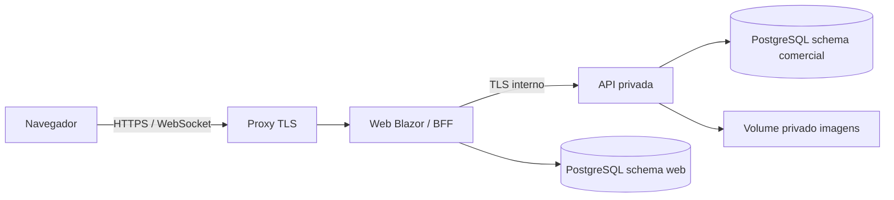

# 10 — Deploy e ambientes

## Topologia planejada

Docker Compose executa Web, API, PostgreSQL e proxy. Apenas proxy publica porta em produção; PostgreSQL e API não são públicos. Uma réplica Web/API no MVP: evita coordenação de circuitos; não prometer escalabilidade horizontal. Persistir dados, imagens e key ring em volumes separados. Chamadas servidor → API usam certificado confiável; não desabilitar validação TLS. Desenvolvimento pode usar certificados locais confiados por rotina explícita.

## Ambientes

| Ambiente | Configuração | Dados |
| --- | --- | --- |
| Desenvolvimento | SDK fixado; Compose local; User Secrets/variáveis locais | Sintéticos descartáveis |
| Teste | Banco isolado, credenciais efêmeras, relógio controlável | Fixtures reproduzíveis |
| Homologação | Igual à topologia de produção, TLS e volumes reais | Sintéticos, sem dados pessoais reais |
| Produção | Secrets externos, mínimo privilégio, logs e backup | Reais somente após Q-03 resolvida |

Fuso comercial proposto `America/Cuiaba`; locale pt-BR. Configurar `APP_TIME_ZONE` equivalente no host Web/API e testar a conversão; não alterar relógio UTC do banco para resolver relatórios. Nome/URL/host, provedor, domínio e certificados são Q-02 antes do bloco 10.

## Segredos e configuração

Documentar nomes de configurações em `.env.example`, sem valores válidos: conexões de runtime/migration, bootstrap, base URL interna API e configurações TLS. Senhas, certificados e chaves não entram no Git, imagem Docker ou logs. Definir permissões de volume e usuário não root dos containers. Separar usuário comercial, usuário web e executor de migrations.

## Deploy e rollback

1. Selecionar commit/tag e imagens imutáveis com patch fixo. Validar pipeline e migrations em homologação.
2. Colocar sistema em manutenção e encerrar tráfego/circuitos que escrevem; confirmar ausência de operações em andamento.
3. Fazer backup consistente de PostgreSQL, imagens e key ring; registrar versão de schema e versão da aplicação.
4. Executar migrations revisadas com usuário DDL em tarefa única. Inicializar primeiro administrador apenas no primeiro deploy com segredo externo e remover segredo de bootstrap após uso.
5. Iniciar serviços, validar readiness e executar smoke autenticado: entrada, confirmação e cancelamento com dados de teste segregados de registros reais.
6. Abrir tráfego e observar erros/locks/expiração de sessão. Não expor detalhes de health.

Rollback de binário só é permitido se schema permanecer compatível. Se migration é destrutiva/incompatível, manter manutenção e restaurar conjunto de backup em ambiente isolado para validar antes de substituir; registrar perda de alterações posteriores. Nunca executar downgrade destrutivo automático.

## Backup, restauração e observabilidade

Meta inicial (H-06): backup diário criptografado, retenção 30 dias, cópia fora do host, RPO <= 24 h e RTO <= 4 h. Antes de produção, demonstrar restore de banco + arquivos + chaves e medir tempo. Backups precisam proteger PII e credenciais; acesso restrito. Não afirmar RTO cumprido sem medição.

Logs estruturados com traceId, duração, status, falhas de login e erro de transação sem dados sensíveis. Métricas mínimas: erros 5xx, p95 HTTP, conexões DB, locks/deadlocks, espaço de disco e último backup válido. Alertar responsável quando backup falha ou readiness cai; responsável é definido em Q-02.

## Gate de publicação

CA-16 a CA-18, RNF-01/04/05/06 e [módulo 10](../modules/10-PUBLICACAO.md). Sem backup restaurável, TLS, Q-02/Q-03 resolvidas e credenciais de bootstrap removidas, publicação com dados reais permanece bloqueada. Ambiente de demonstração sintético pode ser publicado após Q-02 e gates técnicos.

