# 01 — Dependências

## Grafo e ordem

```mermaid
flowchart LR
    B00[00 Fundação] --> B01[01 Autenticação]
    B01 --> B02[02 Funcionários]
    B02 --> B03[03 Clientes]
    B03 --> B04[04 Produtos]
    B04 --> B05[05 Estoque]
    B05 --> B06[06 Vendas]
    B03 --> B06
    B06 --> B07[07 Dashboard]
    B07 --> B08[08 Relatórios]
    B08 --> B09[09 Homologação]
    B09 --> B10[10 Publicação]
    B10 -. novo escopo .-> B11[11 Catálogo e pedidos]
```

A cadeia impõe a ordem administrativa mesmo quando a dependência técnica direta não existe. Módulo não usa recurso futuro para passar seu gate.

## Dependências materiais

| Bloco | Reutiliza | Acrescenta | Condição externa |
| --- | --- | --- | --- |
| 00 | Documentação | Solução, contexts, baseline, Compose | SDK .NET 10, Docker e provedor compatível |
| 01 | API/Web/DB e contratos | Identity, sessões, policies, bootstrap | Segredo local seguro e certificados |
| 02 | Identity/contas | Funcionário e FK única de usuário | Nenhuma |
| 03 | Policies e auditoria | Cliente e histórico vazio | Q-01 pode revisar dados mínimos |
| 04 | Policies | Produto/categoria/marca, imagem, saldo zero | Volume de imagens; hipótese UN |
| 05 | Produto/saldo | Movimento manual e idempotência | PostgreSQL real para disputa |
| 06 | Cliente/produto/saldo/movimento | Venda/item e baixa/estorno | Hipóteses comerciais confirmadas na validação |
| 07 | Venda/estoque | Projeções de indicadores | Fuso configurado |
| 08 | Fórmulas e filtros | Projeções/CSV | Nenhuma |
| 09 | Todos os fluxos | Relatório de evidências e correções | Recursos de teste/carga |
| 10 | Homologação aprovada | Ambiente publicado e recuperação | Q-02, Q-03 para dados reais |
| 11 | MVP publicado | Escopo a definir | Q-04 e autorização de início |

Revisão documental: módulo11 agora contém recorte mínimo detalhado como proposta ADR-18, com RF-21–24/RN-21–24. A proposta ainda precisa aceite/ajuste em Q-04 e não modifica a sequência MVP. Consulte [a matriz](06-MATRIZ-MODULOS.md) para requests, páginas e testes por bloco e a análise de ausência de dependências futuras.

## Gestão de bloqueios

Falta de Docker bloqueia comprovação transacional, mas permite revisão documental e testes unitários disponíveis. Registrar limitação sem marcar integração como aprovada. Falta de domínio/host não bloqueia implementação local, mas bloqueia publicação. Q-03 não bloqueia demonstração com dados sintéticos. Não contornar restrição com token no navegador, EF InMemory ou senha versionada.

## Mudanças transversais

Alteração de quantidade inteira para fracionada exige revisar Domain, colunas, DTOs, formulários, CSV e cenários de concorrência. Alteração de autenticação exige ADR e revisão de BFF/API/deploy/testes. Modificar indicador exige atualizar RF-17/19, dashboard, relatórios e aceites juntos.

