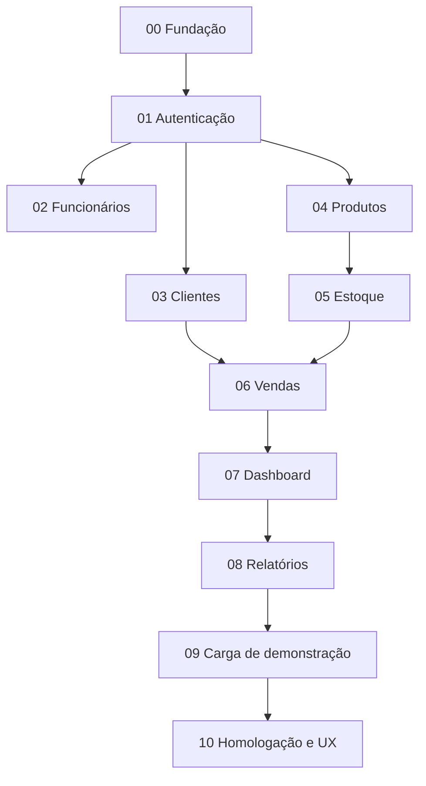

# 01 — Dependências oficiais

O sistema é executado localmente com **um único banco MongoDB Atlas** para uso e demonstração. Não existe bloco de deploy ou catálogo online.

| Bloco | Pré-requisitos | Resultado |
| --- | --- | --- |
| 00–08 | Conforme especificações já implementadas | Base funcional do TCC |
| 09 | 00–08 | Gerar dados de usuários, funcionários, clientes, produtos, estoque, vendas e histórico; restaurar somente dados da carga no banco existente |
| 10 | 00–09 aprovados | Auditar funcionamento, corrigir bugs, revisar layout responsivo e preparar apresentação presencial |

**Dependência crítica:** o Bloco 10 só pode ser aprovado depois que carga e restauração do Bloco 09 forem verificadas. O processo de homologação não adiciona uma segunda instância ou banco.
